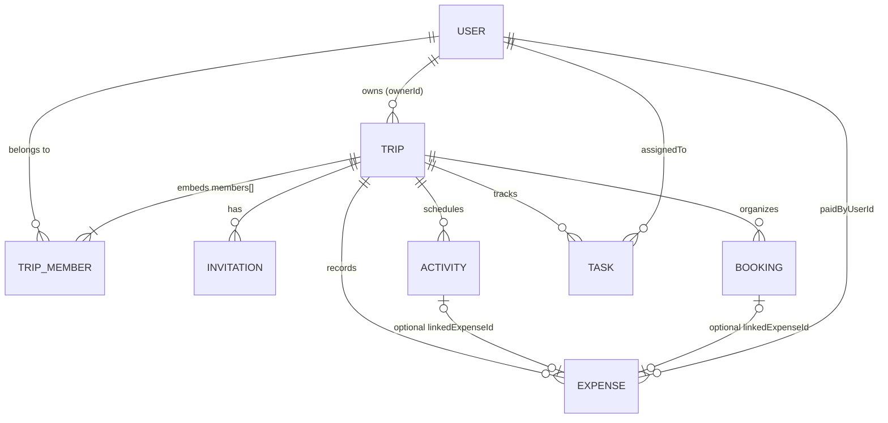

# System Architecture & Data Model

## Layered Backend Design

TripSplit Planner uses a clear **Router → Middleware → Controller → Service → Model** separation:

1. **Routes (`server/src/routes/`):** Declarative endpoints, rate limiters, and Zod validation middleware bindings.
2. **Middleware (`server/src/middleware/`):**
   - `verifyRequestOrigin`: Blocks untrusted cross-origin `POST`/`PATCH`/`DELETE` requests.
   - `requireAuth`: Verifies JWT from `httpOnly` cookie `tripsplit_token` and hydrates `req.user`.
   - `requireTripMember` / `requireTripOwner`: Validates `:tripId` ObjectId format (`400`), checks trip existence (`404`), and enforces trip membership/ownership (`403`).
   - `errorHandler`: Normalizes Zod, Mongoose, and `AppError` exceptions without leaking stack traces or secrets.
3. **Domain Services (`server/src/services/`):**
   - `conflict.service.js`: Pure UTC timestamp overlap engine.
   - `expense.service.js`: Deterministic integer paise splitting, per-person estimates, paid-only settlements, and What-If Simulator.
   - `pulse.service.js`: Rule-based 100-point Trip Pulse readiness index.
4. **Mongoose Models (`server/src/models/`):** Indexed collections with strict schema invariants.

---

## Entity-Relationship Diagram

---

## Core Algorithmic Invariants

### 1. Schedule Conflict Detection (`conflict.service.js`)
Two non-cancelled activities `A` and `B` conflict if and only if:
- `A.id !== B.id`
- `A.status !== 'cancelled' && B.status !== 'cancelled'`
- `A.startAt.getTime() < B.endAt.getTime() && B.startAt.getTime() < A.endAt.getTime()`

Touching endpoints (`A.endAt === B.startAt`) evaluate to `false` (no conflict). Overnight activities spanning midnight in `trip.timezone` are compared as UTC instants and mapped onto every local calendar day they span.

### 2. Integer Paise Splitting & Settlements (`expense.service.js`)
- All INR amounts are stored in integer **paise** (`1 INR = 100 paise`).
- **Equal Split:** Unique `participantIds` are sorted lexicographically by string ID. With $N$ participants:
  `base = Math.floor(amountMinor / N)`, `remainder = amountMinor % N`.
  The first `remainder` participants receive `base + 1`, and the rest receive `base`. Sum is strictly equal to `amountMinor`.
- **Custom Split:** Validates `sum(shareMinor) === amountMinor` with zero negative entries and trip membership verification.
- **Per-Person Estimated Cost:** `plannedShareMinor + paidShareMinor` across the participant's actual expenses. Joining a trip never retroactively alters older expense shares.
- **Settlements:** Uses **PAID expenses only** (`netBalanceMinor = totalPaidOutMinor - paidShareMinor`). Asserts `sum(netBalanceMinor) === 0`, then matches sorted creditors and debtors deterministically.

### 3. Referential Deletion Strategy
- Deleting a **Trip** (Owner only) cascades and deletes all `Invitation`, `Activity`, `Booking`, `Task`, and `Expense` documents referencing `tripId`.
- Deleting an **Expense** atomically sets `linkedExpenseId = null` on any referencing `Activity` or `Booking`.
- Deleting an **Activity** or **Booking** sets `linkedActivityId = null` or `linkedBookingId = null` on any referencing `Expense` without erasing financial records.
- Removing a **Member** who participates in existing expenses is blocked with `409 Conflict` (`MEMBER_HAS_FINANCIAL_RECORDS`).

